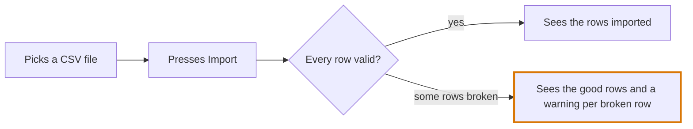
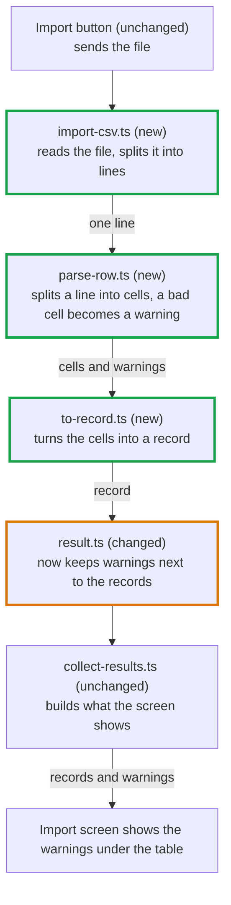

# Part 2: how the change works and the reading order

Two mermaid diagrams show what the change does, then a numbered list says which
order to open the files in. GitHub lists files alphabetically, so this part
saves the reader that.

## The user flow

What a person does and sees, step by step, as a `flowchart LR`.

- Each path the change adds or changes MUST be drawn. Untouched paths stay out.
- A node is an action or a screen in plain words: "Picks a CSV file". File and
  function names MUST stay out.
- A branch (error, cancel, retry) gets its own labelled arrow:
  `-->|some rows broken|`.
- The step that behaves differently now gets the `changed` class.

No person in the loop, as in a CI job or a migration? Draw what starts it and
what comes out.

## What happens inside

The code path behind that flow, as a `flowchart TD`, one node per step.

- A node MUST say what the file does in this change, after its name. Bad:
  `parse-row.ts`. Good: `parse-row.ts (new)<br/>splits a line, a bad cell
  becomes a warning`.
- Each node SHOULD carry `(new)`, `(changed)` or `(unchanged)`, and new or
  changed nodes get their class.
- An arrow label says what passes along or what it changes: `-->|record|`,
  `-->|writes uploads|`. A file with no caller yet joins with a dotted `-.->`.
- The last node MUST be the effect a person or another system sees.
- Tests and config stay out of it, they go in the reading order.

One file and a test? Skip this diagram and write one line saying it isn't
needed.

## Rules for both diagrams

- A label with brackets, quotes, a colon or a slash MUST sit in double quotes,
  or the block fails to render. Backticks MUST stay out of labels.
- A diagram SHOULD stop at twelve nodes. A bigger change gets one per flow.

## A link under each diagram

VS Code chat draws a `mermaid` block. Claude and the terminal show it as code,
so each diagram MUST get a link under it that opens the picture. Build it with
`scripts/mermaid-link.py` from this skill's folder, feeding it the block's text:

```sh
python3 <skill folder>/scripts/mermaid-link.py <<'EOF'
flowchart LR
  A[Picks a CSV file] --> B[Presses Import]
EOF
```

The diagram sits after the `#` in the link, and the browser doesn't send that
part to mermaid.live.

## The reading order

Numbered, one line each, saying why the file comes at that point. Start where
the data starts or where the simplest piece is, end where it ties together.
Every changed file MUST appear, tests and config last.

````markdown
## How the change works

### User flow



[Open the diagram](<link from mermaid-link.py>)

### What happens inside



[Open the diagram](<link from mermaid-link.py>)

### Reading order

1. `result.ts`, to see what a warning is. It turns up everywhere after that.
2. `to-record.ts` and `parse-row.ts`, small and self contained, read them with
   their tests.
3. `import-csv.ts`, the main file of the PR, the rest exists for it.
4. `collect-results.ts`, unchanged, but this is where you see whether the
   warnings reach the output.
5. The test and lint config, last, they only wire the new files in.
````
